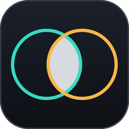
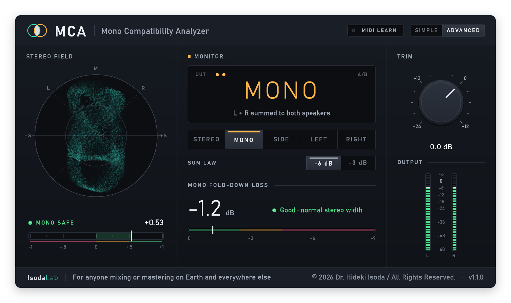
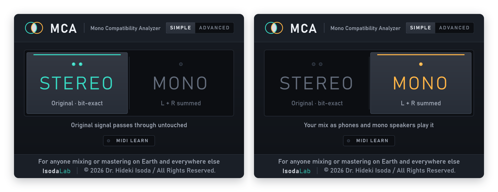
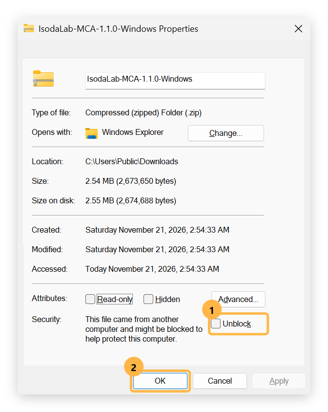
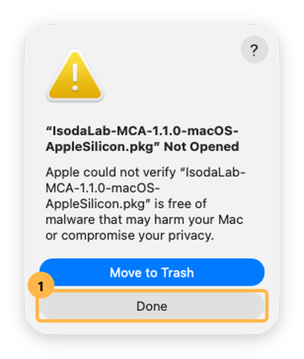
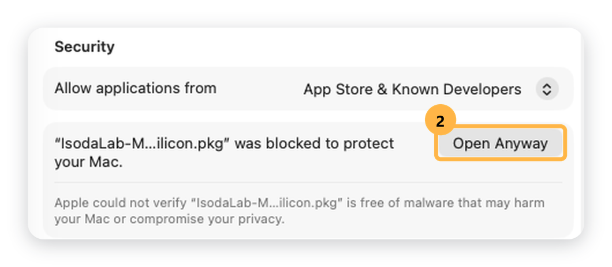
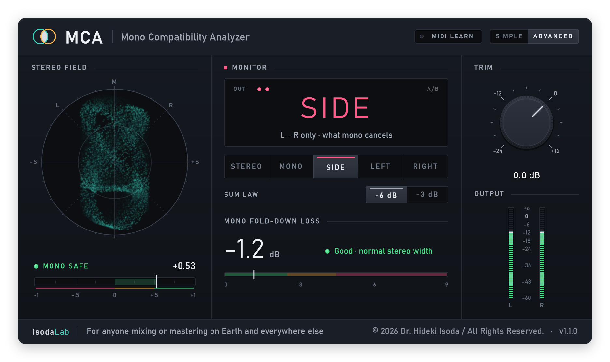

<p align="center">
  
</p>

<h1 align="center">MCA</h1>
<p align="center"><b>Mono Compatibility Analyzer</b><br>
IsodaLab<br>
<i>Free professional audio software, created for the global audio community.</i></p>

<p align="center">
  <a href="https://github.com/isodalab/mca/releases/tag/v1.1.0"><b>Download 1.1.0</b></a> ·
  <a href="#install-on-windows">Install on Windows</a> ·
  <a href="#install-on-macos">Install on macOS</a> ·
  <a href="#install-on-linux">Install on Linux</a> ·
  <a href="#using-mca">Using MCA</a>
</p>

<p align="center">
  
</p>

**MCA is free plug-in software for precision, professional sound engineering, for anyone mixing or mastering on Earth and everywhere else.** It folds your stereo mix to mono, the way phones, Bluetooth and smart speakers, club systems and mono broadcast will play it, and shows you exactly what that fold-down does to your mix.

Most listeners never hear your mix the way you do on studio monitors. A wide synth that sounds glorious in stereo can all but vanish on a phone speaker; a reverb return out of phase can hollow out a vocal on the radio. MCA lets you hear and measure that in a click, right on your master bus, before anyone else does.

MCA is a VST3 plug-in for **Windows**, a VST3 and Audio Unit plug-in for **Macs with Apple silicon**, and a VST3 and LV2 plug-in for **Linux**. In your DAW it appears as **MCA** by **IsodaLab**, in the *Analyzer* category.

## Download

| Platform | Package | Requirements |
|---|---|---|
| **Windows** | [IsodaLab-MCA-1.1.0-Windows.zip](https://github.com/isodalab/mca/releases/download/v1.1.0/IsodaLab-MCA-1.1.0-Windows.zip) | 64-bit Windows 10 or 11, a VST3 host |
| **macOS** | [IsodaLab-MCA-1.1.0-macOS-AppleSilicon.pkg](https://github.com/isodalab/mca/releases/download/v1.1.0/IsodaLab-MCA-1.1.0-macOS-AppleSilicon.pkg) | Mac with Apple silicon (M1 or later), macOS 11 or later, a VST3 or Audio Unit host |
| **Linux** | [IsodaLab-MCA-1.1.0-Linux-x86_64.tar.gz](https://github.com/isodalab/mca/releases/download/v1.1.0/IsodaLab-MCA-1.1.0-Linux-x86_64.tar.gz) | 64-bit Linux (x86_64), glibc 2.35 or later (Ubuntu 22.04+, Debian 12, Fedora 36+, Arch, …), a VST3 or LV2 host |

The Windows and Linux packages contain the plug-in, a step-by-step install guide, the Quick Start guide and the license; the Linux package adds a small install script. The macOS installer puts both the VST3 and the Audio Unit in place. [SHA256SUMS.txt](https://github.com/isodalab/mca/releases/download/v1.1.0/SHA256SUMS.txt) lists the checksums. There is no account and no license key; installation takes about a minute.

> **Upgrading from Isoda MCA 1.0.x?** MCA is the same plug-in under the IsodaLab name, and your saved projects keep loading it. The macOS installer and the Linux install script remove the old `Isoda MCA` files for you. On Windows, delete `C:\Program Files\Common Files\VST3\Isoda MCA.vst3` before you copy the new one, so your DAW doesn't list MCA twice.

## What it does

- **Stereo and Mono at a click.** Switch between your untouched stereo mix and its mono fold-down instantly, or click the big mode display for a quick A/B.
- **100% transparent in Stereo.** In Stereo, and whenever your DAW bypasses the plug-in, the audio passes through bit for bit. Not a single sample is altered, so MCA can live on your master bus permanently.
- **Five monitor modes.** Stereo, Mono (L+R), Side (L−R, everything that disappears in mono), Left and Right.
- **Measurement you can trust.** A goniometer for the stereo image, a phase-correlation meter, and a *mono fold-down loss* readout that tells you, in dB, how much energy the mix loses when summed.
- **Your choice of sum law.** −6 dB, which keeps centre-panned sources at the same level, or −3 dB for equal-power summing.
- **Monitor trim and output meters.** Level-match the mono fold-down by ear; the trim never touches the stereo signal.
- **Hands-free switching.** Assign any button, pad or knob on a MIDI controller with MIDI Learn, or map your DAW's own controller to the *Mono* parameter.
- **Two views.** *Advanced* shows everything; *Simple* is one large Stereo / Mono switch for quick checks and client sessions.

<p align="center">
  
</p>

## Install on Windows

1. **Unblock the download.** Right-click the ZIP → **Properties**. At the bottom of the *General* tab, tick **Unblock** (1), then click **OK** (2). Do this *before* extracting, so Windows doesn't flag every file inside.

   <p align="center"></p>

2. **Extract and copy.** Right-click the ZIP → **Extract All…**, then copy the **`IsodaLab MCA.vst3`** folder into `C:\Program Files\Common Files\VST3\`. Click **Continue** when Windows asks for administrator permission.
3. **Rescan plug-ins** in your DAW (see [Finding MCA in your DAW](#finding-mca-in-your-daw)).

<details>
<summary><b>If Windows or your browser blocks it</b></summary>

MCA is free and isn't code-signed with a paid certificate, so Windows treats it as *unrecognized*. It contains no network code and collects no data.

| What you see | What to do |
|---|---|
| **Edge:** "…isn't commonly downloaded" | Hover over the download, click **…** → **Keep** → **Show more** → **Keep anyway**. |
| **Chrome:** "Suspicious download" | Click **Keep** in the downloads list. |
| Your antivirus quarantines the files | Restore them and add an exception for the `IsodaLab MCA.vst3` folder. |
| **Smart App Control** (Windows 11): your DAW lists MCA as failed, or doesn't show it after a rescan | Smart App Control can refuse unsigned plug-ins and has no override. The only way around it is to switch it off under *Windows Security → App & browser control → Smart App Control settings*. On many Windows 11 versions it can't be switched back on without resetting Windows, so weigh that before you do it. |

</details>

## Install on macOS

1. **Download** `IsodaLab-MCA-1.1.0-macOS-AppleSilicon.pkg` and double-click it.
2. **macOS shows an alert** saying the installer was *Not Opened*. That's expected: MCA is free and isn't notarized with a paid Apple Developer ID. Click **Done** (1), not *Move to Trash*.

   <p align="center"></p>

3. **Open System Settings → Privacy & Security** and scroll down to **Security**. Next to *"IsodaLab-MCA-1.1.0-macOS-AppleSilicon.pkg" was blocked to protect your Mac*, click **Open Anyway** (2). Enter your password (or use Touch ID) and confirm with **Open Anyway**.

   <p align="center"></p>

4. **The installer opens.** Click **Continue**, **Agree** to the license, then **Install**. It puts both the VST3 and the Audio Unit in place.

## Install on Linux

1. **Extract** the download with your file manager, or in a terminal:

   ```bash
   tar xzf IsodaLab-MCA-1.1.0-Linux-x86_64.tar.gz
   ```

2. **Run the install script** from the extracted folder:

   ```bash
   cd IsodaLab-MCA-1.1.0-Linux-x86_64
   ./install.sh
   ```

   It copies the VST3 to `~/.vst3` and the LV2 to `~/.lv2`, so no root password is needed. Running it again updates an existing installation; `./install.sh --uninstall` removes MCA.
3. **Rescan plug-ins** in your DAW (see [Finding MCA in your DAW](#finding-mca-in-your-daw)).

MIDI Learn reads controllers that appear as ALSA MIDI devices. If your controller only exists in JACK, route its MIDI to the plug-in in your DAW, or map it to the *Mono* parameter instead.

## Finding MCA in your DAW

MCA is listed as **MCA** by **IsodaLab**, in the *Analyzer* category. If it doesn't appear, rescan your plug-ins:

| DAW | How to find MCA |
|---|---|
| **Ableton Live** | Settings → Plug-Ins → turn on the VST3 system folder (and Audio Units on a Mac) → **Rescan**. |
| **Ardour / Mixbus** | Edit → Preferences → Plugins → **Scan for Plugins**. On Linux, MCA is available as VST3 and LV2. |
| **Bitwig** | Settings → Locations (on Linux, make sure `~/.vst3` is listed); Bitwig rescans on start. |
| **Carla** (Linux) | Add Plugin → **Refresh**. |
| **Cubase / Nuendo** | Studio → VST Plug-in Manager → Rescan all. If MCA is listed as blocklisted, select it and click **Reactivate**. |
| **DaVinci Resolve Studio** | DaVinci Resolve → Preferences → System → Audio Plugins: make sure the VST3 folder (and Audio Units on a Mac) is enabled, then restart Resolve. Insert MCA in a Fairlight track's effects slot, or drag it from Effects → Audio FX onto a clip. |
| **Digital Performer** | DP checks plug-ins when it starts. If MCA is missing, open Preferences → Audio Plug-ins, make sure MCA is enabled, and restart DP. Insert it from a track's or the master's insert slot (listed under IsodaLab). |
| **FL Studio** | Options → Manage plugins → **Find installed plugins**. |
| **GarageBand** | Settings → Audio/MIDI → tick **Enable Audio Units**. |
| **Logic Pro** | Logic Pro → Settings → Plug-in Manager. If MCA shows *failed*, select it and click **Reset & Rescan Selection**. Insert it from an Audio FX slot → Audio Units → IsodaLab → MCA. |
| **Pro Tools** | **Not supported.** Pro Tools only loads plug-ins in Avid's AAX format. |
| **Pyramix** (Windows) | Pyramix picks MCA up from the standard VST3 folder. Restart Pyramix after installing, then insert MCA from a strip's plug-in slot (listed under IsodaLab). |
| **Qtractor** (Linux) | View → Options → Plugins: make sure `~/.lv2` (or `~/.vst3`) is among the paths, then restart Qtractor. |
| **Reaper** | Settings → Plug-ins → VST → **Re-scan** (on Linux, make sure `~/.vst3` is in the path list). |
| **Renoise** | Preferences → Plug/Misc → **Rescan**. |
| **Sequoia Pro** (Windows) | Make sure `C:\Program Files\Common Files\VST3` is among Sequoia's VST plug-in folders in its plug-in settings, then rescan or restart Sequoia. MCA is listed under IsodaLab. |
| **Studio One** | Settings → Locations → VST Plug-Ins → **Reset Blocklist**, then restart. |
| **Tracktion Waveform** | Settings → Plugins → **Scan for new plugins**. |

## Using MCA

Insert MCA as the **last plug-in on your master bus**, after your limiter and meters, so that it only changes what you hear. Click **MONO** to hear the fold-down and **STEREO** to return. Stereo is bit-exact, so the plug-in can stay in place; still, it's good practice to switch back to Stereo before you export.

<p align="center">
  
</p>

### Monitor modes

| Mode | What you hear | Use it to… |
|---|---|---|
| **Stereo** | Your mix, untouched | Reference |
| **Mono** | (L + R) on both speakers | Hear the mix as phones, clubs and mono broadcast play it |
| **Side** | (L − R) only | Hear exactly what *disappears* in mono: wide synths, reverbs, out-of-phase elements |
| **Left / Right** | One channel on both speakers | Check each side on its own, or pick the clean channel of a dual-mic recording |

### Reading the meters

- **Stereo field (goniometer).** A vertical line means mono; a wide cloud means wide stereo; a horizontal shape means out-of-phase content that will cancel. The display zooms to fit the signal, so its *size* shows the shape of the image, not the loudness. Hover over it for a reminder.
- **Phase correlation.** +1 means the channels are identical; above +0.5 is mono safe; between 0 and +0.5 is wide (check that the important parts survive); below 0 means parts of the mix will cancel in mono.
- **Mono fold-down loss.** How much energy the mix loses when summed: 0 dB loses nothing, about −3 dB is typical of very wide material, and anything below −4.5 dB usually points to a phase problem worth investigating.

### Switching from a MIDI controller

- **MIDI Learn:** click **MIDI LEARN**, then press a button or pad, or move a knob. *Toggle* (the default) switches on every press; *Follow* means Mono while the control is held or above its midpoint. MCA reads the controller directly, so no MIDI routing is needed, and the assignment is saved with your project.
- **Your DAW's own mapping:** MCA has an on/off parameter called **Mono**. Map it with Cubase's MIDI Remote or Quick Controls, Ableton's MIDI Map, Logic's Controller Assignments or Reaper's Learn.

### Pulling narration out of a video's stereo audio

MCA is just as useful in post-production. Put it on the dialogue or production track in your DAW, or in a video editor that hosts VST3 plug-ins (DaVinci Resolve Studio, Premiere Pro, VEGAS Pro and others), then render with the mode you need:

- **Voice recorded on one channel**, say a lavalier on the left and the camera mic on the right: **Left** or **Right** takes the clean channel and puts it on both speakers. The correlation meter tells you which case you have: two different mics read low, while a dual-mono copy reads +1.
- **Voice in the centre over stereo music:** **Mono** keeps the centred voice at full level while wide music, reverb and ambience partly cancel.
- **The opposite, a voice-free bed:** **Side** removes whatever sits in the centre and leaves the wide parts of the mix.

MCA works with stereo placement; it isn't an AI voice separator. It works best when the voice is centred or has a channel of its own.

## Privacy

MCA collects no data. It makes no network connections, has no analytics or telemetry, and needs no account, registration or license key. It listens to your MIDI controllers only on your own computer, for the MIDI switch. Its settings are stored in your DAW project, nowhere else.

## License

MCA is **freeware**: free for personal, educational and commercial use on any number of computers. You're welcome to share the unmodified packages with anyone, free of charge, with the license and copyright notice intact. It is not open source. The full terms are in [LICENSE.txt](LICENSE.txt).

Built with the [JUCE](https://juce.com) framework. VST is a registered trademark of Steinberg Media Technologies GmbH; Audio Units is a trademark of Apple Inc. The macOS and Linux versions embed the Barlow typeface (SIL Open Font License 1.1). Windows is a trademark of Microsoft Corporation; macOS of Apple Inc.; Linux is a registered trademark of Linus Torvalds.

## About

Developed by **Dr. Hideki Isoda** at **Texas Tech University**. Created as a contribution to the global audio community, this software is provided free of charge to support audio professionals, educators, students, and researchers worldwide.

This project is 100% self-funded; no grants have been applied for. I believe it can be an excellent example for the Music Informatics course I teach, and I hope it may become an inspiration for my students.

## Transparency

To be transparent: I do use AI tools to help organize my ideas and catch mistakes, but this work is built on decades of coding practice and professional experience. I still sketch out programs like this in paper notebooks and on a whiteboard!

## Thank you

To my fantastic students and colleagues, who were so willing to test MCA in their own sessions, and whose honest feedback makes it better at every step: thank you.

And to my wife, **Hyejin**, who is always supportive of me and my projects: thank you, for this one and for all the others.

— Hideki Isoda

<sub>© 2026 Dr. Hideki Isoda / All Rights Reserved.</sub>
